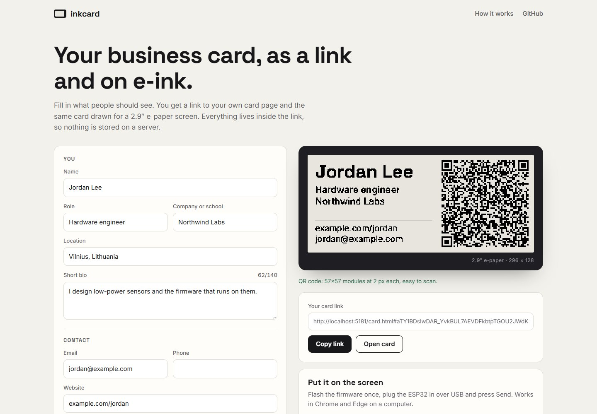
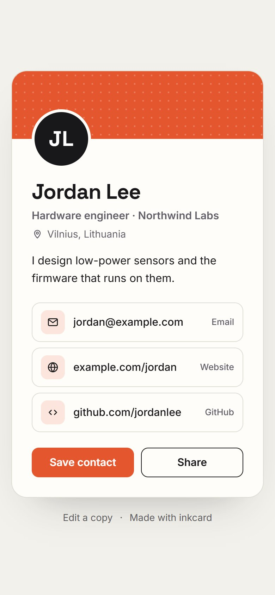

# inkcard

A business card that is a link and an e-ink screen. Fill in your details once and you get:

- **a link** to your own card page, with a Save contact button that adds you to the other person's phone;
- **the same card on a 2.9″ e-paper screen** driven by an ESP32, with a QR code that opens that page.

There is no backend and no account. The whole card is stored inside the link, after the `#`, so it never reaches a server.

**Try it:** [cmigle.github.io/inkcard](https://cmigle.github.io/inkcard/) · [example card](https://cmigle.github.io/inkcard/card.html#aTY0xDsIwDAB_YvkBUL7ACChiZDfENEaNXdmJwvMRZWE8nXR3Mc-kmJjhRJ4HOSPrLMrscDVvZYhmTHQPuMmi0mOHSVrppEJwxswhs-JiY7_aYMdgDfNA0oytMD7F65ZthRp610DTr6kTvLb7kd9U14Wnh1WAPzj8_Ac)



<p>
  
  
</p>

## Features

- **Pixel-exact preview.** The editor draws the card at the panel's resolution (296 × 128) and reduces it to pure black and white, so what you see is what the screen shows.
- **QR code that actually scans.** The code is drawn at 2 px or more per module. If the link gets too long for that, the editor says so and offers to point the QR code at your website instead.
- **Card page.** Profile, links, Save contact (vCard 3.0) and Share. The accent colour is yours, and text on it switches between dark and light for contrast.
- **Send to card.** One button sends the image to the ESP32 over USB with Web Serial. The board keeps it in flash and redraws it on every restart. E-ink holds the picture with the power off.
- **No build step.** Plain HTML, CSS and JavaScript modules. The only library is a QR code generator.

## How it works

```
Editor ──► fields joined, deflated, base64url ──► card.html#a…  (card page, Save contact)
   │
   └──► 296×128 canvas ──► 1-bit bitmap (4736 bytes) ──► Web Serial ──► ESP32 ──► flash ──► e-paper
```

The bitmap is sent as one frame:

| Bytes | Content |
|---|---|
| 4 | `INK1` |
| 2 | image length, little endian (4736) |
| 4736 | image: rows top to bottom, 1 bit per pixel, most significant bit first, 1 = black |
| 1 | sum of the image bytes, modulo 256 |

The browser pulses the board's reset line, waits for `INKCARD READY`, sends the frame and waits for `OK` or `ERR <reason>`.

## Hardware

- ESP32 dev board with a USB-to-serial chip (CP2102 or CH340), for example an ESP32 DevKit V1
- Waveshare 2.9″ e-Paper module V2, 296 × 128

| Panel | ESP32 |
|---|---|
| VCC | 3V3 |
| GND | GND |
| DIN | GPIO 23 |
| CLK | GPIO 18 |
| CS | GPIO 5 |
| DC | GPIO 17 |
| RST | GPIO 16 |
| BUSY | GPIO 4 |

## Flash the firmware

1. Arduino IDE → Boards Manager → install **esp32** by Espressif.
2. Library Manager → install **GxEPD2** and **Adafruit GFX Library**.
3. Open `firmware/inkcard/inkcard.ino`, choose **ESP32 Dev Module** and upload.

The screen shows a short "No card yet" note until you send a card. For a different 2.9″ panel, change `PANEL` at the top of the sketch.

## Run the editor locally

JavaScript modules need a web server, so opening the file directly won't work:

```
npx serve web
```

Send to card works in Chrome and Edge on a computer. Boards with native USB (ESP32-S3, C3) may need a press of the reset button when the editor asks for it.

## Project structure

```
web/index.html        Editor
web/card.html         Card page the link opens
web/js/data.js        Card fields, link encoding, links
web/js/screen.js      E-ink renderer, QR code, bitmap and PNG export
web/js/serial.js      Web Serial upload
web/js/vcard.js       Save contact
web/vendor/qrcode.js  QR code generator by Kazuhiko Arase (MIT)
firmware/inkcard/     ESP32 sketch
```

## Licence

MIT
